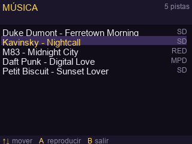

# gpi-music-player

Reproductor de música para el **RetroFlag GPi Case** (consola portátil con Raspberry Pi Zero).

La GPi Case es una Game Boy con pantalla de 2.8" y cruceta, pero sin reproductor de música.
Esto añade una sección **«Música»** a EmulationStation: una lista de canciones con su
artista y álbum, reproducción con los botones de la consola y una pantalla de «sonando ahora»
con barra de progreso.

Funciona en **Recalbox 9** y en **RetroPie 4**, y en ambos casos en la GPi Case original
(320×240) y en la GPi Case 2W (640×480).




---

## Qué hace

- **Sección «Música» en EmulationStation**, igual que cualquier otro sistema de la consola.
- **Biblioteca mixta**: MP3/OGG/FLAC/WAV/M4A de la microSD **y** de la red (Samba/NFS montado en
  `/mnt`) **y** de servidores **MPD** (Music Player Daemon) en la LAN.
- **Tags y duración** leídos del propio archivo (ID3v2, Vorbis comments, RIFF, atoms MP4),
  sin instalar nada: si no hay tags se deduce «artista - título» del nombre del archivo.
- **Controles con los botones**: cruceta para moverse, A para reproducir/pausar, B para salir,
  X/L/R para saltar de pista, Start para el menú de opciones.
- **Menú de opciones**: aleatorio, repetir, volumen, reescanear la biblioteca y salir.
- **Sin dependencias que instalar**: dibuja sobre el framebuffer con Pillow si está, o con
  pygame/SDL2 si no (que es el caso de Recalbox), leyendo los botones por evdev.

## Requisitos

**Recalbox 9** (recomendado en el GPi Case) o **RetroPie 4.x**, con el parche de pantalla de
RetroFlag y los botones funcionando.

| | Recalbox 9 | RetroPie 4 |
|---|---|---|
| Instalación | `./install.sh` (sin root) | `sudo ./install.sh` |
| Ubicación | `/recalbox/share/system/gpi-music` | `/opt/gpi-music` |
| Carpeta de música | `/recalbox/share/roms/music` | `~/RetroPie/roms/music` |
| Dibujado | pygame (SDL2) o Pillow | Pillow (o pygame) |
| Registro en ES | `systemlist.xml` | `es_systems.cfg` |

## Instalación

```bash
git clone https://github.com/eduardoarburola/gpi-music-player.git
cd gpi-music-player
./install.sh
```

O en una sola línea:

```bash
curl -sSL https://raw.githubusercontent.com/eduardoarburola/gpi-music-player/main/install.sh | bash
```

En RetroPie, antepón `sudo` a los dos comandos.

El instalador:

1. comprueba que hay `python3` y un reproductor de audio (`mpv`, `mpg123`, `ogg123` o `ffplay`);
2. instala el código y el lanzador;
3. crea la carpeta de música;
4. registra el sistema **«Música»** en EmulationStation (guardando copia de seguridad);
5. en Recalbox, reinicia EmulationStation si el gestor web está activo.

Después, copia tu música a la carpeta indicada y reinicia EmulationStation: en el carrusel
aparecerá la sección «Música».

> En Recalbox el directorio `/recalbox/share` es la carpeta que ves por Samba, así que puedes
> copiar la música y los archivos desde el PC sin tocar la microSD.

## Controles

| Botón | En la biblioteca | Reproduciendo |
|-------|------------------|---------------|
| Cruceta ↑↓ | mover la selección | — |
| Cruceta ←→ | — | saltar ±15 s |
| A / Intro | reproducir la canción | pausar / seguir |
| B / Retroceso | salir a EmulationStation | volver a la biblioteca |
| X / L / R | pista anterior / siguiente | pista anterior / siguiente |
| Start / Select | menú de opciones | menú de opciones |

Si tu consola asigna las teclas de otra forma, puedes reasignarlas en
`~/.config/gpi-music/config.json` (mapa de códigos de tecla → acción).

## Configuración

El archivo vive en `~/.config/gpi-music/config.json` y se crea solo la primera vez que se guarda.
Los valores por defecto:

```json
{
  "library": {
    "local_paths": ["/recalbox/share/roms/music", "/recalbox/share/music"],
    "scan_mounts": true,
    "mount_roots": ["/mnt"],
    "mpd_hosts": [],
    "extensions": [".mp3", ".ogg", ".oga", ".opus", ".wav", ".flac", ".m4a", ".mp4", ".aac", ".wma"],
    "recursive": true
  },
  "player": {
    "volume": 0.7,
    "backend": "auto",
    "shuffle": false,
    "repeat": false,
    "alsa_mixer": "",
    "seek_step": 15
  },
  "ui": { "theme": "pixel", "font_size": 15, "show_cover": true, "fps": 20 }
}
```

Las rutas por defecto se ajustan solas a la plataforma (Recalbox o RetroPie) en el primer arranque.

### Biblioteca en la red

**Samba/NFS**: monta el share y el reproductor detecta solo las carpetas de `/mnt`.
Por ejemplo, si el share se llama `nas` y dentro hay una carpeta `Music`, aparecerá como
`nas/Music (red)`.

```bash
sudo mkdir -p /mnt/nas
sudo mount -t cifs //192.168.1.50/musica /mnt/nas -o guest,vers=3.0
```

**MPD**: añade el servidor a `mpd_hosts` y sus canciones aparecerán mezcladas con el resto:

```json
"mpd_hosts": [["192.168.1.50", 6600]]
```

### Volumen por software

La GPi Case tiene una rueda de volumen física (hardware). Si prefieres controlarlo por software,
indica el mezclador de ALSA:

```json
"alsa_mixer": "Headphone"
```

## Uso desde SSH

```bash
gpi-music --scan                    # lista la biblioteca y las fuentes detectadas
gpi-music --preview /tmp/ux.png     # guarda una captura de la interfaz
gpi-music --config /ruta/config.json
```

## Problemas frecuentes

**No se ve la sección «Música» en EmulationStation**
EmulationStation solo lee la configuración al arrancar: reinícialo o reinicia la consola.
En Recalbox, comprueba que el sistema quedó registrado:

```bash
grep -A3 'name="music"' /recalbox/share/system/.emulationstation/systemlist.xml
```

**Los botones no responden**
En RetroPie el usuario debe pertenecer al grupo `input`:

```bash
groups | grep input
sudo usermod -aG input pi     # y reinicia la sesión
```

En Recalbox los botones del GPi Case se_MAPean con `mk_arcade_joystick`; el reproductor lee
tanto eventos de teclado como de joystick, así que funciona con cualquiera de los dos modos.

**La pantalla sale en blanco o con colores raros**
Comprueba el framebuffer y sus permisos:

```bash
cat /sys/class/graphics/fb0/bits_per_pixel
```

Si el framebuffer es de 16 bpp, en RetroPie instala `python3-numpy` para que la conversión a
RGB565 sea exacta:

```bash
sudo apt-get install python3-numpy
```

**No suena**
El GPi Case usa audio PWM: la configuración correcta en `/boot/config.txt` es
`dtoverlay=audremap,pins_18_19` y `snd_bcm2835.enable_compat_alsa=1`.
Comprueba el volumen con `alsamixer` y prueba la reproducción con `mpg123 archivo.mp3`.
En Recalbox, `aplay -l` debe listar la salida PWM.

## Desarrollo

```bash
python3 -m unittest discover -s tests -v    # sin dependencias
python3 -m gpi_music --preview /tmp/ux.png  # vista previa de la interfaz
```

Estructura:

```
gpi_music/
  app.py        máquina de estados: biblioteca, reproducción, navegación
  ui.py         dibujo de las vistas sobre el lienzo
  display.py    elige el backend de dibujo (Pillow o pygame) y la pantalla
  shim.py       compatibilidad: Pillow si está, sustituto con pygame si no
  fb.py         framebuffer: detección de formato y volcado de píxeles
  input.py      lectura de evdev y traducción a acciones
  library.py    escaneo de carpetas y montajes
  metadata.py   tags y duración sin dependencias
  mpd.py        cliente mínimo de MPD
  player.py     motores de audio (mpv / mpg123 / ogg123 / ffplay)
  config.py     configuración en JSON
scripts/
  gpi-music              lanzador
  patch_es_systems.py    alta/baja del sistema en RetroPie
  patch_recalbox.py      alta/baja del sistema en Recalbox 9
```

## Licencia

MIT.
